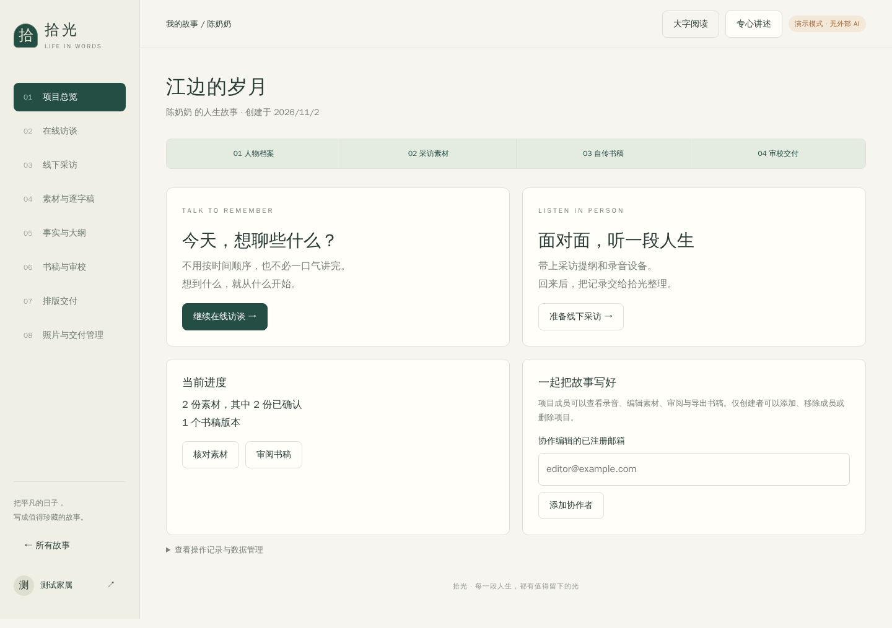

# 拾光 · Life Story Studio

一个可自行部署的中文口述自传工作室。支持在线文字/语音访谈、线下采访录音导入，以及从事实核对、整书大纲到审校、照片入书和线下排版交付的完整流程。

**MIT 开源 · Python / FastAPI · 原生网页 · SQLite · 可配置 AI 服务**

默认提供无密钥演示模式。演示模式不进行真实语音识别或AI润色，不会伪造转写结果；配置服务商后启用真实处理。



## 两种采集模式

- **在线**：进入专心讲述模式 → 听问题 → 文字或分段录音 → 试听并上传 → 核对识别文字 → 继续追问。录音每秒暂存到本机，可刷新恢复、失败重试或下载。
- **线下**：填写采访任务单 → 下载采访手册 → 人工访谈录音 → 上传 → 分片识别 → 核对逐字稿。成功分片有检查点，重试不重复发送已缓存片段。

两种模式共享同一个人物项目，支持随时补充素材。录音权限、浏览器实现及本地存储可用性影响采集可靠性；上线录音需要 HTTPS。

## 完整工作流

1. 创建人物档案，记录处理授权，填写方言、别称、目标读者、禁谈主题和目标字数。
2. 采集、修订和确认素材，单独标记哪些素材允许入书。
3. 生成带原文引用的事实卡与整书大纲，核实人物/时间/事件，维护补访问题。
4. 按确认大纲跨素材写章；可调整顺序、合并为新版本、编辑及恢复历史。
5. 跨章审查提出有原文依据的矛盾疑点，由人核实；不自动裁定记忆真假。
6. 上传照片、填写说明及使用范围；已确认照片进入 Word 和排版包。
7. 创建者登记讲述者对具体整书版本及用途的确认；修改后需重新确认。
8. 导出正式 Word/排版包，登记线下制作规格、PDF校样、校样确认、印制及物流进度。

确认记录不是身份核验或公开出版许可。实际出版、印刷、支付和退款由运营方与相应服务商处理。

## 快速启动

需要 Python 3.10+；音频处理另需 FFmpeg 和 ffprobe。

Windows PowerShell：

```powershell
cd life-story-studio
.\start.ps1
```

Linux / WSL / macOS：

```bash
cd life-story-studio
./start.sh
```

或使用 uv：

```bash
uv venv
uv pip install -r requirements.lock
cp .env.example .env
.venv/bin/python run.py
```

访问 **http://127.0.0.1:8000** 后自行注册，无默认账户密码。启动脚本不会覆盖已有 `.env`。停止服务使用 Ctrl+C。

Docker（镜像包含 FFmpeg）：

```bash
cp .env.example .env
# 配置后启动Web与独立任务进程
docker compose up --build -d
```

## AI 配置

文本和语音可使用不同服务商。配置 `.env` 后重启：

```dotenv
AI_MODE=live
TEXT_BASE_URL=https://your-text-provider.example/v1
TEXT_API_KEY=your-text-key
TEXT_MODEL=your-text-model
ASR_BASE_URL=https://your-asr-provider.example/v1
ASR_API_KEY=your-asr-key
ASR_MODEL=your-asr-model
ASR_RESPONSE_FORMAT=json
```

- 文本接口：兼容 `POST /chat/completions`，支持 `messages`、`response_format={"type":"json_object"}`，响应 `choices[0].message.content`。
- 语音接口：兼容 `POST /audio/transcriptions` multipart，接收 WAV、`model`、`language=zh`，响应包含 `text`。
- 可按供应商能力设置 `ASR_RESPONSE_FORMAT=verbose_json` 或 `diarized_json`。有时间戳/说话人标签则保留；无则明确是切片定位，不制造假标签。
- URL 填API根路径，不包含具体方法路径。非兼容协议需新增适配器。
- 密钥仅在服务端；真实调用失败不会回退为演示。实际模型名、方言能力、上下文容量和费用由供应商决定。

协议参考：[文本接口](https://developers.openai.com/api/reference/resources/chat)、[语音接口](https://developers.openai.com/api/reference/resources/audio/subresources/transcriptions/methods/create)。

## 任务、费用和资料管理

- 在线追问与长任务分开处理，可取消任务、暂停项目AI处理；取消不会撤回已发生的请求和费用。
- 可设置项目配额、登记采访/听校/排版等实际费用；供应商报告的真实用量可按配置单价估算，未知费用不虚构。
- 项目创建者可邀请编辑。编辑保存校验版本，防止过期页面覆盖他人修改。
- 排版包仅含确认正文、已允许入书照片、最小来源索引与交付清单。
- 私人档案包可含原始素材/录音/历史，只有创建者可以导出，不应当作排版包转发。
- 原声分享需创建者主动确认，最长7天、可撤回。配置 `PUBLIC_BASE_URL=https://...` 后可生成二维码；此链接不是永久纸书音频承诺。
- 可配置 STARTTLS SMTP 邮件重设密码，也提供离线管理员恢复工具。

## 部署与测试

```bash
python -m pytest -q
```

测试使用临时数据库与模拟模型，不需要真实密钥。FFmpeg测试会真实解码并向本地模拟HTTP服务上传，不代表实际识别准确率。浏览器验收需另安装 Playwright/Chromium：

```bash
pip install playwright
python -m playwright install chromium
# 默认访问已启动的 localhost:8000 测试服务
python tests/browser_smoke.py
# 独立启动模拟服务，验证刷新、试听、失败恢复和账户隔离
python tests/browser_recording_recovery.py
```

- [部署、备份与恢复](docs/DEPLOYMENT.md)
- [完整交付清单与明确边界](docs/COMPLETION.md)
- [试点与服务执行手册](docs/PILOT_AND_SERVICE.md)
- [产品架构](docs/PRODUCT.md)
- [测试记录](docs/VALIDATION.md)
- [联网调研与需求演进](docs/RESEARCH_AND_IMPROVEMENTS.md)
- [参与开发](CONTRIBUTING.md) · [安全报告](SECURITY.md)

当前是单主机部署：SQLite、本地文件与一个任务worker。已提供分离Web/worker及租约保护，但没有宣称跨主机高可用或无限并发。真实模型、真人试点、移动真机、公网域名/SMTP和实际印刷需在部署环境验收，详见交付清单。

## License

代码采用 [MIT](LICENSE)。用户上传的口述、录音与照片不随代码许可证开放授权。不要将真人资料、密钥或运行数据库提交到仓库。
