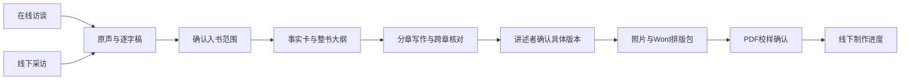

# 产品架构

拾光围绕一个人物项目组织家庭自传生产。在线文字/分段录音与线下录音汇入素材库；素材确认后进入事实卡、大纲、写章、审校、版本确认、照片排版及线下交付。

## 模块

- `main.py`：账户、项目、素材、基础访谈、审校和导出。
- `editorial.py`：引用校验、事实卡、大纲、多源章节、跨章疑点、合章和历史恢复。
- `operations.py`：采访任务单、照片、私人档案、限时原声分享、制作订单与校样。
- `runtime.py` / `worker.py`：任务配额、取消/暂停、双通道消费者、租约、用量和成本。
- `ai.py`：可配置文本/ASR适配器、分片缓存、供应商时间戳和用量。
- `accounts.py` / `admin.py`：邮件密码恢复、管理员恢复、离线备份还原。
- `recording-store.js`：分片录音本地存储与账户/项目隔离；`app.js` 提供工作室与专心讲述界面，扩展视图独立加载。

## 数据与授权

创建者管理成员、分享、私人档案与最终交付确认；协作编辑可采集与编辑内容。当前没有把购买者、采访员和只读家属拆成独立细分权限。实际分工可记在任务单，权限更细的团队应另行扩展并验证。

`projects.revision` 跟踪写作素材/任务单变化；照片等交付内容使用 `delivery_revision`。书稿绑定素材版本；整书确认绑定章节正文、顺序、审校状态与交付版本的SHA-256。照片内容或说明变化会使确认失效。校样同时绑定文稿摘要、文件摘要和制作规格；旧校样不能用于推进新规格印制。

事实引文在服务端校验其存在于素材中的位置。大纲须覆盖允许入书的素材；不确定事实须人工核实。模型没有权力决定公开范围或自行确认交付。

原声和原始识别分段保留在项目内，修订逐字稿不抹掉原始资料。不入书只控制新书稿，不等于撤回一切AI处理。需要暂停时使用项目处理开关；需要删除时删除素材/整个项目并执行运营方备份保留政策。

## 工程限制

支持一个主机、一份SQLite数据库和一个任务worker，Web可独立进程。租约避免重复消费者恢复任务，不能替代分布式队列。模型任务有输入/组合数量上限，超限拒绝而非截断。录音缓存不是加密保管库，浏览器清理存储或系统终止可能造成尾部数据损失。

当前没有自动支付、真实印厂/出版社接口、实时双工电话服务或身份认证签约。相应业务以明确的人工交付记录与配置边界承接。外部验收范围见 [交付清单](COMPLETION.md)。
